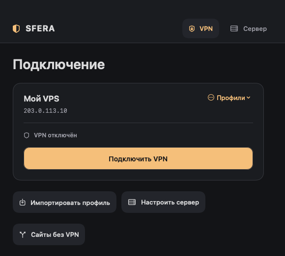
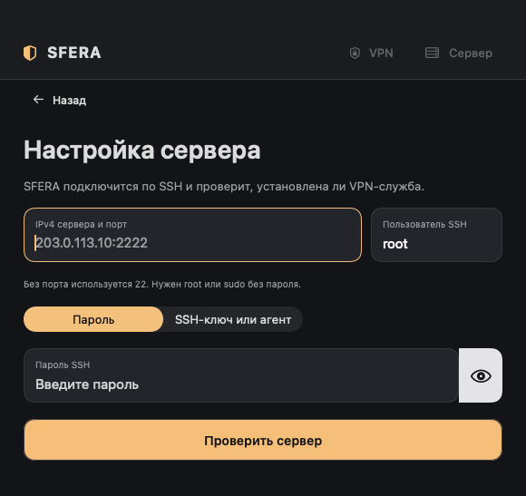
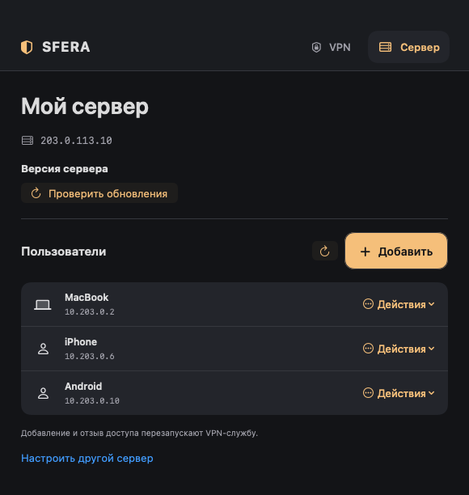
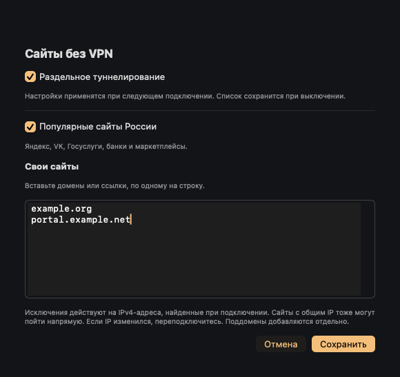

  

<h1 align="center">SFERA</h1>

<strong>VPN на вашем VPS</strong>

  <a href="https://github.com/SFERA-TUN/sfera-client/releases">Скачать</a> ·
  <a href="#быстрый-старт">Быстрый старт</a> ·
  <a href="docs/BUILD.md">Сборка из исходников</a> ·
  <a href="https://github.com/SFERA-TUN/sfera-server">Сервер</a>

  
   Интерфейс macOS с демонстрационным профилем

SFERA подключает macOS, Windows, Android и iOS к вашему VPN-серверу. С Mac можно установить сервер по SSH, выдать отдельные профили для устройств, отозвать доступ и проверить обновления. На телефоне и Windows достаточно импортировать профиль.

## Установка клиента

| Платформа | Требования | Где взять |
| --- | --- | --- |
| **macOS** | macOS 14+ | [Собрать `SFERA.app`](docs/BUILD.md#macos). При первом подключении может понадобиться пароль администратора Mac для установки сетевого помощника. |
| **Windows** | Windows 11 x64 | Скачать и распаковать [ZIP](https://github.com/SFERA-TUN/sfera-client/releases), открыть `SFERA.exe` и подтвердить запрос прав администратора. [Инструкция](windows/README.md). |
| **Android** | Android 8+, ARM64 или x86-64 | Скачать APK в [Releases](https://github.com/SFERA-TUN/sfera-client/releases). Для установки APK вручную Android может попросить разрешение для приложения, из которого вы открыли файл. |
| **iOS** | iOS 17+ | Для установки на iPhone нужна сборка, подписанная Apple. Архив `.xcarchive.zip` в [Releases](https://github.com/SFERA-TUN/sfera-client/releases) предназначен для разработчиков. [Как собрать и подписать](docs/BUILD.md#ios). |

## Быстрый старт

### 1. Настройте сервер с Mac

Подготовьте отдельный VPS на Debian 12/13 или Ubuntu 24.04/26.04 с публичным IPv4, `systemd` и `/dev/net/tun`. Для установки нужны доступ по SSH, права `root` или `sudo` без запроса пароля, свободные TCP-порты 80, 443 и 7443 и UDP-порт 443. Откройте входящие TCP 80 и 443 и UDP 443 в файрволе VPS. TCP 7443 используется локально на сервере.

1. В SFERA нажмите **Настроить сервер**. Укажите IPv4, при необходимости SSH-порт, имя пользователя и способ входа. Поддерживаются пароль, SSH-ключ и SSH-агент.
2. Нажмите **Проверить сервер**. Сверьте отпечаток с выводом `ssh-keygen -lf /etc/ssh/ssh_host_ed25519_key.pub` в консоли VPS.
3. Если SFERA ещё не установлена, нажмите **Установить SFERA** и введите email для TLS-сертификата. Клиент выберет пакет для `x86_64` или `aarch64` из последнего стабильного [серверного релиза](https://github.com/SFERA-TUN/sfera-server/releases), проверит SHA-256 и передаст пакет по SSH.
4. Если сервер уже работает, клиент загрузит основной профиль и список пользователей. Для неполной установки клиент предложит восстановление.

  

### 2. Подключите устройства

- **На Mac:** выберите профиль и нажмите **Подключить VPN**. Готовый профиль также можно загрузить через **Импортировать профиль**.
- **На Windows, Android или iOS:** на Mac откройте **Сервер → Пользователи**, добавьте пользователя для устройства и экспортируйте его профиль. На другом устройстве нажмите **Импортировать профиль**, выберите JSON-файл и нажмите **Подключить VPN**.

Выдавайте каждому устройству отдельный профиль. JSON содержит ключ доступа к VPN, поэтому передавайте его приватно. Вкладка **Сервер** на Mac позволяет экспортировать профиль повторно или отозвать доступ конкретного пользователя. Добавление и отзыв доступа перезапускают VPN-службу.

  

## Сайты без VPN

На macOS, Windows 11, iOS 17+ и Android 13+ можно направить выбранные сайты напрямую. Отключите VPN, откройте **Сайты без VPN** и включите **Раздельное туннелирование**. Выберите готовый список популярных российских сайтов или добавьте свои домены и ссылки, по одному на строку. Сохраните настройки и подключитесь заново.

Исключения выключены по умолчанию. При выключении список сохраняется. Маршруты строятся по IPv4, полученным при подключении. Поддомены добавляются отдельно, а сайты на одном IP используют один маршрут. Если адрес изменился, переподключитесь. Если для сайта не удалось найти IPv4, клиент укажет его и остановит попытку подключения. Исправьте список или выключите исключения и повторите попытку.

  

## Обновление сервера

На Mac откройте **Сервер → Проверить обновления**. Клиент предложит обновление, когда в [серверных релизах](https://github.com/SFERA-TUN/sfera-server/releases) появится более новая стабильная версия с поддержкой обновления установленного сервера.

Обновление сохраняет пользователей, их ключи, адреса профилей и TLS. Во время перезапуска действующие подключения кратковременно прерываются. Если новая VPN-служба не запускается, серверный установщик восстанавливает предыдущую версию.

## Сборка и код

Клиенты используют транспорт из [SFERA Server](https://github.com/SFERA-TUN/sfera-server). Файл [`core.ref`](core.ref) фиксирует ревизию транспорта для сборок клиента.

[Локальная сборка и подпись](docs/BUILD.md) · [GitHub Actions](https://github.com/SFERA-TUN/sfera-client/actions) · [Сообщить об ошибке](https://github.com/SFERA-TUN/sfera-client/issues/new)
